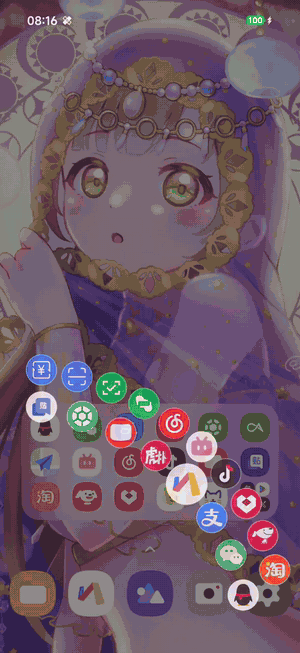
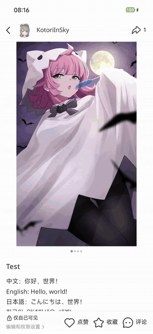
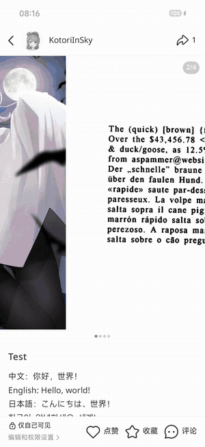
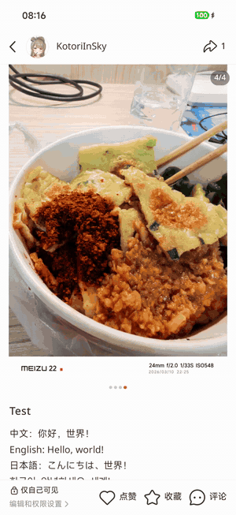
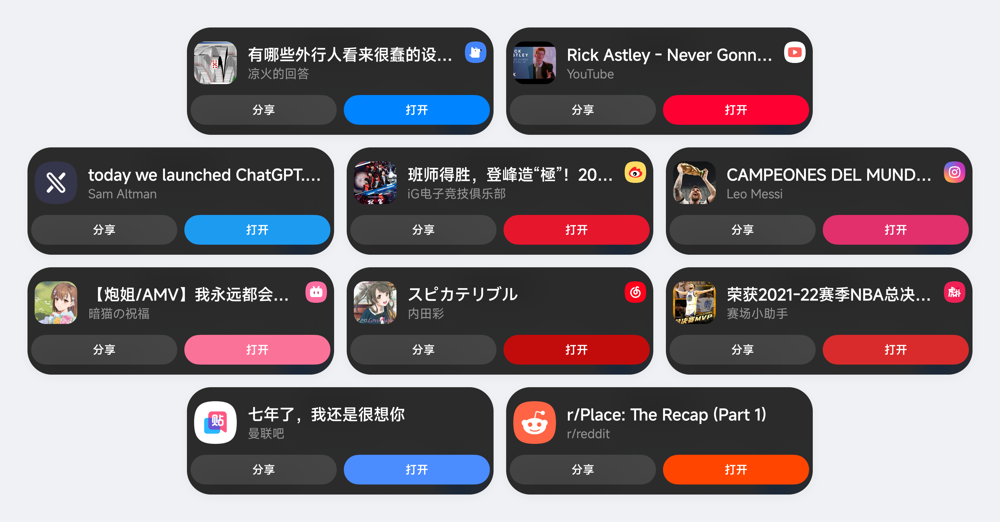

# Tsuzuri-缀合

HyperOS 4 交互增强模块：小窗、应用索引、识屏、复制直达。

Tsuzuri 是一个 LSPosed 模块，把各家系统里成熟的交互设计带到 HyperOS 4，并使用超级岛、控制中心、传送门等系统入口接入。

所有功能默认关闭，可单独开关。不修改系统分区，关闭功能后不安装对应 hook。

## 亮点

| 功能 | 你能得到什么 |
| --- | --- |
| **扇形小窗** | 底角上滑展开应用环，松手用小窗打开，支持快捷方式 |
| **侧滑索引** | 边缘滑动按拼音找应用，提供高斯模糊和液态玻璃背景 |
| **识屏增强** | 更多应用可识字，卡片可编辑、分享、播放动图和实况 |
| **复制直达** | 内置 105 个平台规则，复制链接或口令后在超级岛预览并跳转 |
| **小窗多开** | 所有应用可同时开多个小窗 |

## 功能

示例中的应用图标来自酷安 [@NURKE_](https://www.coolapk.com/u/2131758) 的图标包「补全计划One」，不随 Tsuzuri 提供。

### 手势与小窗

<table>
  <tr>
    <td width="280" align="center">
       
      底角上滑，松手进入小窗
    </td>
    <td>
      <b>扇形小窗</b>
      <ul>
        <li>支持应用和快捷方式，可手动排序</li>
        <li>触发区域、布局和动画均可调整</li>
      </ul>
    </td>
  </tr>
  <tr>
    <td width="280" align="center">
       
      沿字母条滑动，松手打开应用
    </td>
    <td>
      <b>侧滑索引</b>
      <ul>
        <li>中文应用按拼音分组，可显示收藏和最近使用</li>
        <li>背景支持高斯模糊和液态玻璃</li>
      </ul>
    </td>
  </tr>
</table>

### 识屏

<table>
  <tr>
    <td align="center" width="33%">
       
      长按识别图片，同屏选取文字
    </td>
    <td align="center" width="33%">
       
      文档页面识别
    </td>
    <td align="center" width="33%">
       
      长按后在卡片内预览实况
    </td>
  </tr>
</table>

- 更多应用可识字，支持整页翻译、复制和分享。
- 卡片可编辑、分享，并播放动图和实况。
- 控制中心磁贴一键识别整屏。

### 复制直达

同一套卡片适配各平台的封面、标题、作者和品牌色

- 内置 105 个平台规则，可在超级岛或原生胶囊中提示。
- 自动清理链接跟踪参数，支持快递单号和自定义规则。

### 其他

| 功能 | 说明 |
| --- | --- |
| 打开新应用 | 安装新应用后，在胶囊中提示打开 |
| 打开音乐应用 | 连接耳机后，在胶囊中推荐音乐应用 |
| 临时屏幕常亮 | 屏幕变暗后轻触，提示临时常亮 |
| 分享面板排序 | 常用应用固定在分享面板最前 |
| 精简选字菜单 | 选中文字时不显示问小爱和 AI 写作 |
| 完美状态栏 | 截图、录屏时满格显示，并隐藏通知图标和超级岛 |
| 负一屏完美小部件 | 解除尺寸限制，可添加本机 Android 小部件 |

## 兼容性

| 项目 | 要求 |
| --- | --- |
| 系统 | HyperOS 4（Android 17） |
| 已测试设备 | Xiaomi 17 Pro |
| 框架 | LSPosed，支持 libxposed API 102 |
| 权限 | Root |

## 安装

从 [Releases](https://github.com/KotoriInSky/Tsuzuri/releases) 下载安装，日常使用选 release 包，调试选 debug 包。

## 反馈与贡献

遇到问题请提交 [Issue](https://github.com/KotoriInSky/Tsuzuri/issues)，并附上 LSPosed 日志、设备型号、系统版本和复现步骤。上传前请检查日志中是否有隐私内容。

欢迎提交 [Pull Request](https://github.com/KotoriInSky/Tsuzuri/pulls)，流程见 [CONTRIBUTING.md](CONTRIBUTING.md)。更新记录见 [CHANGELOG.md](CHANGELOG.md)。

## 开源项目

部分交互参考了魅族 Flyme。感谢以下开源项目，许可详情见 [THIRD-PARTY.md](THIRD-PARTY.md)。

- **框架**：[LSPosed](https://github.com/LSPosed/LSPosed)、[libxposed](https://github.com/libxposed)、[Kotlin](https://github.com/JetBrains/kotlin)
- **界面**：[AndroidX 与 Jetpack Compose](https://github.com/androidx/androidx)、[Material Icons](https://github.com/google/material-design-icons)、[MiuiX](https://github.com/compose-miuix-ui/miuix)、[AndroidLiquidGlass](https://github.com/Kyant0/AndroidLiquidGlass)、[MaterialKolor](https://github.com/jordond/MaterialKolor)
- **内置代码与数据**：[libwebp](https://chromium.googlesource.com/webm/libwebp)、[tracking_number_data](https://github.com/jkeen/tracking_number_data)、[oembed](https://github.com/iamcal/oembed)、[tracking-query-params-registry](https://github.com/mpchadwick/tracking-query-params-registry)、[Public Suffix List](https://publicsuffix.org/list/)
- **链接解析参考**：[astrbot_plugin_parser](https://github.com/Zhalslar/astrbot_plugin_parser)、[nonebot-plugin-parser-lite](https://github.com/sokoko-org/nonebot-plugin-parser-lite)、[nonebot-plugin-parser](https://github.com/fllesser/nonebot-plugin-parser)、[ParseHub](https://github.com/z-mio/ParseHub)、[FxEmbed](https://github.com/FxEmbed/FxEmbed)、[parse-video](https://github.com/wujunwei928/parse-video)、[lux](https://github.com/iawia002/lux)、[metascraper](https://github.com/microlinkhq/metascraper)、[besticon](https://github.com/mat/besticon)、[yt-dlp](https://github.com/yt-dlp/yt-dlp)
- **设计与格式参考**：[HyperCeiler](https://github.com/ReChronoRain/HyperCeiler)、[HyperIsland](https://github.com/1812z/HyperIsland)、[HyperCopy](https://github.com/1812z/HyperCopy)
